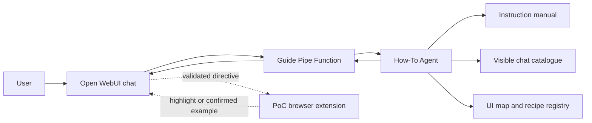
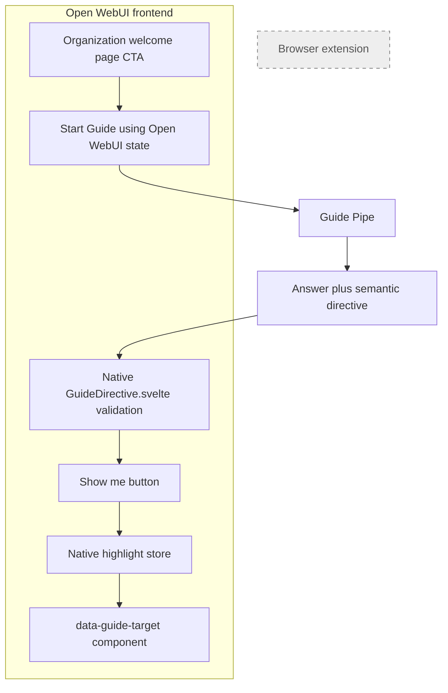

# Open WebUI How-To Agent — project debrief

> **Purpose:** Summarise the proof of concept, explain how the core How-To Agent works, and define the recommended production architecture without a browser extension.

## Executive summary

This project tested whether Open WebUI could support a guided onboarding experience that is more dependable than a prompt-only chatbot. The result is a selectable **Open WebUI Guide** that explains the interface, describes models and agents, reports the chat choices available to the current user, highlights known controls, and offers a consent-gated Hello World demonstration. The proof of concept works without a paid model or external API: a deterministic provider verifies the chat connection, while a source-controlled Pipe Function provides the Guide responses. **The PoC uses a deliberately small draft/example instruction manual and a mock `hello-world` provider; these prove the architecture and interaction flow, but they are not the final organization's operational knowledge base or AI service.**

The main architectural decision was to separate conversation, knowledge, and browser behaviour. Open WebUI owns chat and user-specific model access; the standalone Python package owns guidance rules and validated response contracts; Markdown and YAML files contain the manual, semantic UI map, and approved recipes; and a temporary browser extension performs page-level highlighting and demonstration actions. This separation made the experiment quick to deploy against the official Open WebUI image while preserving clear security and testing boundaries.

The PoC proved the interaction pattern, but the extension should not be part of the final product. The recommended production design is a small organization-owned Open WebUI frontend customization: a native welcome-page CTA, stable semantic markers on existing Svelte components, a native highlight overlay, and a Guide directive component rendered inside assistant messages. The Pipe would continue to request semantic actions such as `model-picker`; it would never supply JavaScript or CSS selectors.

## What was added

| Addition | Responsibility |
| --- | --- |
| [How-To Agent package](../agent/src/howto_agent/) | Loads process and knowledge content, routes supported requests, and constructs validated replies. |
| [Open WebUI Guide Pipe](../openwebui/functions/howto_pipe.py) | Exposes the agent as a selectable Open WebUI chat choice and supplies the current user's visible model catalogue. |
| [Instruction manual](../knowledge/open-webui-instruction-manual.md) | Provides reviewed explanations of Open WebUI, models, agents, onboarding, and the worked example. |
| [Semantic UI map](../knowledge/ui-map.yaml) | Names approved targets such as `model-picker`, `message-composer`, and `new-chat`. |
| [Recipe registry](../knowledge/recipes/) | Defines the small set of fixed, consent-gated demonstrations the UI may run. |
| [Guide Bridge](../openwebui/guide-extension/) | PoC-only CTA, directive rendering, highlighting, confirmation, cancellation, and recipe execution. |

## How the core agent works

The Pipe is a trusted server-side Python Function installed through Open WebUI. Once enabled, it appears in the normal model selector as **Open WebUI Guide**. When the user sends a message, the Pipe extracts the original user prompt, asks Open WebUI for the chat choices visible to that user, converts them into a minimal domain context, calls `HowToAgent.respond(...)`, and serializes the result as Markdown plus any validated UI directive. Open WebUI remains the interaction layer; the Pipe is a thin adapter rather than the home of the product's business rules.



The current agent is deliberately deterministic. The manual loader reads YAML frontmatter and splits the Markdown at every level-two heading, generating stable section IDs such as `what-is-a-model`. The router then matches a small set of supported phrases, selects the corresponding section, and optionally adds a semantic directive. For example, “Show me where I select a model” produces an answer plus the following contract:

```json
{
  "version": 1,
  "kind": "highlight",
  "target": "model-picker",
  "requires_confirmation": false
}
```

The target is checked against the UI map before it leaves the agent. Unknown questions receive an explicit grounded fallback rather than an invented answer. The system can also list the current user's effective chat choices, but it does not guess which models the organization has configured or which choice is best for an unsupported task. This makes the PoC inexpensive, repeatable, and easy to test, while also making its current language understanding intentionally narrow.

## Knowledge source of truth and future AI integration

**The final agent will use the organization-approved Open WebUI instruction manual as its authoritative source of truth.** Answers about how Open WebUI works, which process a user should follow, and what a control means must be grounded in that maintained manual rather than generated from the model's general knowledge. The manual should be versioned against the supported Open WebUI release, reviewed by its owners, and updated through the organization's normal content-governance process.

The current PoC does not yet contain that substantial operational manual. It uses the small source-controlled draft at [`knowledge/open-webui-instruction-manual.md`](../knowledge/open-webui-instruction-manual.md), example process content, a local test catalogue, and the fixed `hello-world` provider. In this version, “reading the manual” means structured lookup rather than AI comprehension: the file is divided into known sections, its `[ui:...]` and `[recipe:...]` references are validated, and deterministic routing selects an exact section. The draft system prompt is a design asset and is not executed at runtime.

For production, the approved manual and any explicitly permitted supporting documents would be parsed into versioned, access-controlled chunks and indexed with both keywords and embeddings. A broader user request would retrieve only the most relevant passages, then send those passages, the user's visible chat choices, and organization-owned capability profiles to an AI model such as Anthropic. The model would interpret the goal and propose an answer or model recommendation, but it would not become the source of truth: responses would remain grounded in retrieved manual passages, ideally with section references. Deterministic code would still reject unavailable model IDs, unsupported UI targets, unapproved recipes, and unsafe actions. Common onboarding questions could remain on the fast deterministic route, providing a graceful fallback during provider errors or timeouts.

---

## Removing the browser extension in the final design

The extension currently performs three browser-only jobs: it inserts the **Getting started** CTA, converts `owui-action` blocks into **Show me** or **Run example** controls, and draws or executes the resulting UI assistance. It was chosen because this repository uses the official prebuilt Open WebUI container and therefore has no Svelte source in which to add those components. It is a useful experiment harness, but it requires per-browser installation and depends on rendered DOM structure, as demonstrated by the compatibility fixes required for CodeMirror blocks and clipped model-selector outlines.

The final implementation should move these responsibilities into the organization's existing Open WebUI frontend. Stable attributes such as `data-guide-target="model-picker"` would be added to `ModelSelector.svelte`, `MessageInput.svelte`, the New Chat control, and assistant-message containers. A small Svelte store would accept only registered target IDs, while `GuideHighlightOverlay.svelte` would scroll to the associated component and display an accessible, cancellable highlight. A `GuideDirective.svelte` component in the assistant response renderer would validate Guide-owned directives and render the native **Show me** button. The organization's welcome page would host the CTA and use Open WebUI's navigation and model state to start a Guide conversation directly.



An Open WebUI Action Function using the platform's `execute` event could provide an interim in-app highlight button without maintaining an extension. However, `execute` runs unsandboxed JavaScript in the page context, so it should use only fixed source-controlled code and should not become the final architecture. The native Svelte approach is safer and more maintainable: component references replace selector guessing, the frontend owns visual state, and the agent remains unable to generate executable browser behaviour.

## Outcome and next steps

The project established the core product pattern: grounded assistance, user-specific capability awareness, semantic UI guidance, explicit consent, and independent validation on both sides of the interface boundary. Automated tests cover content parsing, routing, catalogue filtering, directive validation, cancellation, recipe execution, responsive behaviour, and extension security constraints. The most important lesson is that a dependable How-To Agent is not merely a generated persona; it is a governed combination of knowledge, runtime context, UI contracts, and constrained actions.

The recommended sequence is to preserve the existing Pipe and domain package, connect Anthropic, add indexed retrieval and capability-grounded task planning, then implement the native frontend Guide components in the organization's Open WebUI build. Once the native CTA, directive renderer, highlight service, and any approved demonstration runner pass equivalent acceptance tests, the extension and any interim `execute` Action can be removed completely.
