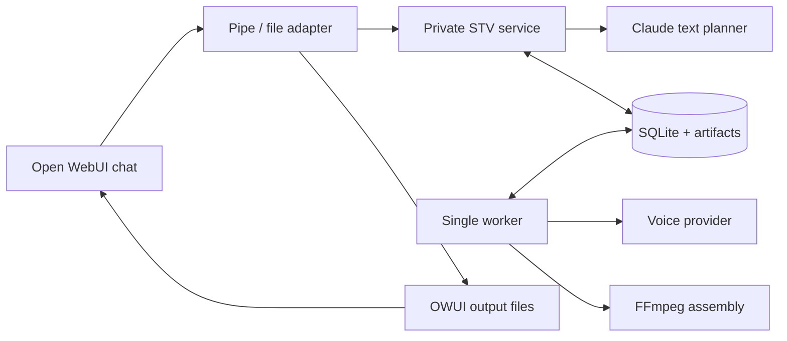

# Script to Voice — architecture cheat sheet

**Presentation reference · 2 November 2026**

**In one sentence:** a selectable Open WebUI workflow that finds exact script dialogue, assigns voices, prepares directed requests and manages downloadable audio.

**30-second explanation:** “The original screenplay remains authoritative. Claude interprets requests and proposes casting or delivery. Python validates those proposals and preserves source wording and order. A durable worker generates and assembles audio, while Open WebUI provides the chat interface and file playback.”

## 1. The architecture at a glance



The voice-provider interface uses **direct ElevenLabs REST** in the local app following live activation. Catalog/design actions are coordinated by the service; durable job rendering runs in the worker. Earlier demonstrations used mock tones; the user will perform the first real-audio test. See the [manual test handoff](C:/Users/Dan/Documents/Codex/OWUI-experiments/draft-owui-instance/docs/script-to-voice/live-elevenlabs-handoff.md).

| Component | Responsibility | Review guide |
|---|---|---|
| **OWUI + Pipe** | Model selection, injected identity, original attachment access and output registration | P04 |
| **Private FastAPI service** | Selection, cast, direction, plans, chat state and job submission | P16 |
| **Claude planner** | Structured intent, casting proposals and source-linked direction annotations | P07 |
| **Deterministic Python code** | Exact resolution, validation, request compilation and source coverage | P02, P06, P13 |
| **SQLite + artifact volume** | Saved projects, revisions, selections, jobs, attempts, budget and audio bytes | P03 |
| **Single worker + FFmpeg** | Durable rendering, failure recovery, audio validation and ordered MP3 assembly | P14–P15 |

There is a separate STV service and worker, sharing one image and named data volume. The existing Guide remains an independent Function. The service has no public host port; OWUI is loopback-bound in this local setup. MCP is excluded.

## 2. Follow the user journey

The [guided UX contract](C:/Users/Dan/Documents/Codex/OWUI-experiments/draft-owui-instance/docs/script-to-voice/guided-user-journeys.md) formalizes six steps and the wrong-model/file/selection and failure paths. Chat responses now derive the current stage from saved state. `help` and `what next` guide users without inference; `wrong model` explains how to leave. A current reviewed-plan step is required before chat generation. This UX delta has not been tested; the user owns the next dummy-FDX acceptance.

Step 3 now defaults to a proposed character-to-voice list, asks for existing voice IDs/links and requires a separate exact confirmation before applying casting. Draft changes and confirmed cast are distinct. Successful selection can use the capped Claude allowance to prepare proposals; viewing a saved review is free of fresh inference. Saving a generated voice stages it for review instead of assigning it automatically. These subsequent changes are also untested.

| Step | What happens behind the chat |
|---|---|
| **Import** | Read original FDX bytes; safe XML parser creates a revision with scenes, characters, text runs and parentheticals |
| **Select** | Recognize an exact command or ask Claude for a proposal; deterministic code returns ordered dialogue IDs |
| **Cast** | Reuse locked choices or offer catalog candidates; accept manual assignments; explicitly design/save/audition new voices |
| **Line direction** | User replies yes/proceed; merge source/inferred/user cues, compile requests and offer one direction-package ZIP for review outside chat |
| **Generate** | Bind authorization to the plan hash and budget; enqueue a persistent job |
| **Retrieve** | Worker saves/combines audio; Pipe shows native animated status while polling saved results, then registers player/downloads automatically; `status` resumes after a long wait/disconnect |

**Three distinct actions:** `select` chooses source; `plan` prepares inspectable requests; `generate` authorizes audio work. A search or question does not automatically become a render job. A plan can still incur Claude usage when uncached direction is needed.

## 3. The data objects to remember

```text
Project → ScriptRevision → Selection
                       + Cast + DirectionPlan
                       → RenderPlan → Job → Chunks / Attempts → Audio artifacts
```

- **Revision:** original-file hash, parsed structure and exact source wording.
- **Selection:** ordered spoken IDs; contextual IDs are stored separately.
- **Cast:** versioned character-to-voice assignments with locks.
- **Direction:** validated annotations over source IDs/offsets, not replacement dialogue.
- **Render plan:** exact payloads, fragment mappings, dependency hashes and usage estimate.
- **Job / attempt:** durable progress plus the outcome of each provider attempt.

Contracts describe these artifacts, but current persistence is mixed: typed models, JSON object records and dedicated SQL job/attempt rows. That distinction is an important review topic.

## 4. Why wording and identity survive the pipeline

**Source text → normalized search text → rendered text are separate representations.**

The parser joins FDX text runs without inventing spaces. The resolver selects IDs against the full manifest. The compiler builds speech from original text plus approved tags, then checks contiguous once-only fragment coverage and script order. Character voice assignments persist across selections; revision reuse requires explicit exact-identity reconciliation.

**Chunk limits:** 2,000 rendered Unicode code points and 10 distinct voices per request. Scene changes create boundaries; oversized speeches are fragmented with source offsets rather than truncated. Unsupported pronunciation substitutions, controls and continuity options remain disabled pending verification.

## 5. The safety and cost controls to explain

| Control | Practical meaning |
|---|---|
| **Server-side credentials** | Provider keys live in the service/worker environment; the Pipe uses a separate private service token |
| **Owner-scoped access** | Identity comes from OWUI's injected context; referenced projects/files/jobs are checked against that owner |
| **Strict proposals** | Unknown fields, invented IDs, unsupported tags and stale dependencies are rejected |
| **Explicit paid actions** | Voice design, auditions and rendering have separate commands; Claude cannot call tools to trigger them |
| **Planner allowance** | $1 cumulative app allowance; $0.05 reserved per attempt, including repairs and uncertain failures |
| **Bounded inference** | 16,000 serialized input bytes and 1,000 output tokens under the configured demo settings |
| **Durability** | Saved work survives reload; successful chunks persist; duplicate submissions reuse the local job |

Reservations persist across restarts and do not automatically reset/refund. They are conservative app allowances, **not actual provider charges or an account-wide spending guarantee**. Speech currently has a character envelope; complete ElevenLabs credit accounting remains outstanding.

**Failure shorthand:** auth errors stop scheduling; rate limits use bounded backoff; uncertain accepted requests are not blindly replayed; cancellation stops later chunks but does not yet abort an active provider request. Audio is decoded to PCM and encoded once for assembly, rather than concatenating MP3 bytes.

## 6. What can we claim in the presentation?

| Claim | Evidence / qualification |
|---|---|
| **Text planning works with real Claude** | Haiku 5.5 passed synthetic-script selection, follow-up, casting-proposal and direction checks through OWUI |
| **The audio workflow works with mocks** | Generated mock voices, multi-chunk jobs, downloads, HTTP ranges and native browser playback were demonstrated |
| **Source coverage is tested** | A 600-line, 30-scene, 12-role fixture compiled to 60 bounded chunks with ordered coverage |
| **Existing Guide is preserved** | Latest recorded run: 113 Python tests and 28 Guide JavaScript checks passed |
| **Real ElevenLabs audio is ready for validation** | Account/model/catalog reads passed; paid synthesis/design and listening-quality acceptance remain open |

**Current wording:** “live text planning and real ElevenLabs integration, with real-audio acceptance pending.” Prior mock-audio demonstrations and real read-only account checks remain separate historical evidence. No tests were run when switching to real speech.

Last recorded planner validation, including failed probes: 10 attempts, estimated token charge **$0.002469**, conservative reservation **$0.50**, remaining app allowance **$0.50**. These are recorded test figures, not a fresh account-balance reading.

Remaining release work includes real ElevenLabs credit/quality validation, pronunciation glossary support, active-request cancellation, broader authenticated multi-user/browser recovery checks, remote CI and backup/upgrade rehearsal. The deep code review is still to be performed section by section.

## 7. Demo commands to keep handy

| Purpose | Example |
|---|---|
| Exact selection | `select scene 12A` or `all Mira's lines` |
| Freeform planning | `Please choose every line spoken by Mira.` |
| Refine | `Keep just those in scenes set at night.` |
| Cast inspection / suggestions | `cast` / `suggest voices` |
| Accept a voice | `cast MIRA as REAL_VOICE_ID` from `voices` |
| Prepare / authorize | `plan` / `generate` |
| Progress / recovery | `status` / `cancel` / `retry failed` |
| Planner allowance | `planner budget` |

Exact commands, cast inspection and cached plans avoid additional inference. Freeform requests, uncached suggestions and direction can use paid Claude calls. For a cost-free demonstration, use the prerecorded results or arrange the appropriate mock-planner configuration first; the mock voice switch alone does not disable Claude.

## 8. What is the source snapshot?

The [source snapshot JSON](C:/Users/Dan/Documents/Codex/OWUI-experiments/draft-owui-instance/docs/script-to-voice/technical-review-snapshot.json) is a **fingerprint manifest of the files the technical guide describes**. It was captured on **2 November 2026 at 16:27 UTC**, while the implementation was uncommitted.

For each of 91 covered source/config/test files, it records:

| Field | Meaning |
|---|---|
| `path` | Repository-relative file location |
| `sha256` | Fingerprint of the exact file bytes at capture time |
| `bytes` / `lines` | Size and line count at capture time |
| `symbols` | Python class/function names and their starting line numbers |

It also records the repository/application roots and Git HEAD. **That HEAD is the older baseline commit `45bce3c`, not a commit containing the new feature.** The fingerprint entries identify the uncommitted source used for the explanation.

### How it maps to the technical guide

- **P00** explains the uncommitted working-tree baseline and introduces the snapshot.
- **Appendix A** is the human-readable file inventory; the JSON is its exact, machine-readable companion.
- **The source links and excerpts in P01–P16** refer to files/functions whose bytes and locations can be checked against the manifest.

**Example:** P13 explains request compilation. The snapshot entry for `draft-owui-instance/agent/src/script_to_voice/directing/compiler.py` records 82 lines, 5,055 bytes, a SHA-256 hash and `compile_plan` starting at line 4. This tells a reviewer which version of the file underlies the explanation.

If a later edit changes a covered file's hash, the source has moved beyond that reference and its affected explanation/excerpt should be rechecked. At original cheat-sheet creation, all 91 covered files matched. The later live-ID guard in the ElevenLabs adapter is a deliberate subsequent source change; the original snapshot remains the earlier review baseline.

**It is not a source-code backup or a Git commit.** It contains hashes and metadata, not restorable copies of the implementation. It cannot recover deleted code or replace committing reviewed changes. It excludes credentials, runtime databases, generated audio and user uploads; the synthetic test fixture is included. Documentation such as this cheat sheet is outside its code/config/test fingerprint set.

## 9. Where to turn for detail

- [Technical review guide](C:/Users/Dan/Documents/Codex/OWUI-experiments/draft-owui-instance/docs/script-to-voice/technical-review-guide.md): P00–P18, code excerpts and later-review questions.
- [Runbook](C:/Users/Dan/Documents/Codex/OWUI-experiments/draft-owui-instance/docs/script-to-voice/runbook.md): configuration, commands, recovery and rollback.
- [Text-planning change document](C:/Users/Dan/Documents/Codex/OWUI-experiments/draft-owui-instance/docs/script-to-voice/text-planning-feature-change.md): native Claude implementation and live-validation details.

**Useful closing line:** “We demonstrated the workflow with real text planning and mock audio, and have now enabled direct ElevenLabs calls. The user-led real-audio test and code review are the next steps.”
