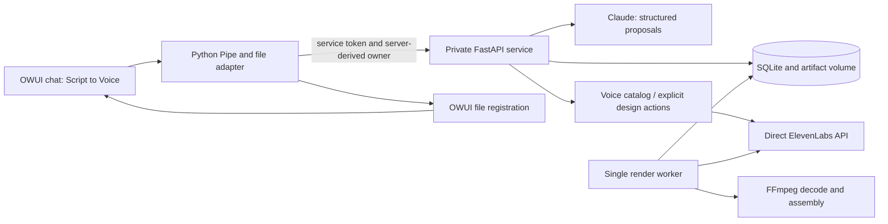

# Script to Voice: technical implementation and staged review guide

**Later progress-UI delta:** v0.3.0 Pipe emits native animated status, polls an owner-scoped job-result route for a bounded browser wait and automatically registers player/download artifacts. Review current Pipe, workflow job progress/result methods and new Pipe/job test definitions alongside P04/P14/P16. The worker/provider/budgets are unchanged. Source contracts were inspected; new tests/browser behavior remain unexecuted, and this historical snapshot is not refreshed to imply coverage.

**Subsequent UX delta:** [guided-user-journeys.md](C:/Users/Dan/Documents/Codex/OWUI-experiments/draft-owui-instance/docs/script-to-voice/guided-user-journeys.md) documents the later six-step chat guidance, mistake recovery, attachment handling and saved-plan generation gate. Review current `service/journey.py`, workflow and Pipe alongside P04/P16 below. New offline regression definitions were added but not run. This guide's original snapshot and source excerpts remain historical; they have not been refreshed to imply coverage of the new code.

**Later casting-review delta:** Step 3 now prepares default proposals and stages user voice IDs/links in `service/cast_review.py`. The user simply replies `confirm cast`; internal scope/version checks protect the latest review and `CastingService.assign_many` applies the group together. Generated-voice save no longer assigns automatically. Review this alongside P09–P11/P16. Default proposals after selection may use the unchanged capped Claude allowance. Additional regression definitions/fixtures were updated but not executed; no new provider calls or live evidence were obtained during implementation.

**Later change:** local ElevenLabs was enabled for user-led testing after this review snapshot (`STV_MOCK=false`, `STV_LIVE_ENABLED=true`). A live-ID guard was added to the direct adapter. No tests were run for that change at the user's request. This guide's source snapshot/excerpts remain the earlier baseline; see the [activation delta and manual handoff](C:/Users/Dan/Documents/Codex/OWUI-experiments/draft-owui-instance/docs/script-to-voice/live-elevenlabs-handoff.md) before treating old mode descriptions or line numbers as current. The original fingerprint manifest is intentionally preserved.

**Snapshot:** 2 November 2026. **Purpose:** explain the current uncommitted implementation so it can be reviewed one part at a time, before further E2E testing or commits.

This document describes code already implemented, the reasons for the changes, the runtime paths, and the checks recorded so far. It is not a new implementation plan or a completed code review. The questions at the end of each part are prompts for the later review, not findings or instructions to change code now.

Only documentation is being created for this request. No application code, configuration, data, budget, running service, or commit is changed by producing this guide. Credentials are deliberately excluded.

## Contents and review order

| Part | Review topic | Main question |
|---|---|---|
| [P00](#p00-working-tree-and-review-baseline) | Working tree and baseline | What belongs to this feature versus the existing relocation? |
| [P01](#p01-architecture-and-runtime-services) | Architecture and services | Where does each responsibility run? |
| [P02](#p02-contracts-identities-and-source-fidelity) | Contracts and source fidelity | What is authoritative and how are references checked? |
| [P03](#p03-storage-migrations-and-ownership) | Storage and ownership | What persists, and what is atomic? |
| [P04](#p04-open-webui-pipe-files-and-installation) | OWUI boundary | How do identity, original files and output files cross the boundary? |
| [P05](#p05-fdx-import-and-revision-provenance) | FDX import | How are exact source bytes and dialogue represented? |
| [P06](#p06-exact-selection-and-follow-up-state) | Selection | How does a request become an exact ordered selection? |
| [P07](#p07-text-planning-and-the-native-anthropic-adapter) | Text planning | What can Claude propose, and what can it never execute? |
| [P08](#p08-planner-spending-controls-and-usage) | Planner budget | How is the demo allowance enforced and reported? |
| [P09](#p09-direct-elevenlabs-api-adapter-and-capabilities) | Direct ElevenLabs API | How are provider capabilities, credentials and uncertain outcomes handled? |
| [P10](#p10-existing-voice-casting-and-revision-reuse) | Casting | How are roles assigned, locked and reconciled? |
| [P11](#p11-voice-design-auditions-and-paid-action-idempotency) | Design and auditions | How do previews become saved voices without duplicate actions? |
| [P12](#p12-direction-annotations-precedence-and-caches) | Direction | How is delivery changed without rewriting dialogue? |
| [P13](#p13-deterministic-request-compilation-and-chunking) | Compiler | How is once-only source coverage proved? |
| [P14](#p14-durable-render-jobs-retries-and-cancellation) | Jobs and worker | What happens on duplicate clicks, failure or restart? |
| [P15](#p15-audio-validation-assembly-and-delivery) | Audio | How are clips checked, combined and played? |
| [P16](#p16-conversational-orchestration-api-and-revised-takes) | Orchestration and API | How do the pieces form one production workflow? |
| [P17](#p17-tests-evidence-and-remaining-release-gates) | Verification | What has actually passed, and what has not? |
| [P18](#p18-proposed-review-and-commit-boundaries) | Review and commits | How could this work be broken into reviewable changes? |
| [Appendix A](#appendix-a-source-and-supporting-file-inventory) | Inventory | Which files need to be accounted for? |
| [Appendix B](#appendix-b-internal-api-reference) | API reference | What routes exist today? |
| [Appendix C](#appendix-c-walk-one-request-through-the-code) | Worked trace | Which functions run for a representative request? |

Suggested follow-up: **“Review P03 against the current code. Explain findings before changing anything.”** Parts can be reviewed individually; P07/P08 and P13/P14 are useful paired reviews because their guarantees depend on each other. No sub-agents, review fixes or commits are implied by this guide.

## P00. Working tree and review baseline

The Git repository root is `C:/Users/Dan/Documents/Codex/OWUI-experiments`. The application is inside `draft-owui-instance`. They are not separate Git repositories. The current HEAD inspected for this document is **`45bce3c` — `working how to agent`**.

Before Script to Voice implementation began, the working tree already showed a relocation: tracked files at the repository root were deleted, and their replacement application directory was untracked. That state was preserved. Consequently, a normal `git diff` does not present all new feature code: much of it is inside an untracked directory. A root-level staging operation could combine the relocation, prior unrelated work, this feature and support material.

A read-only comparison of HEAD paths against their relocated counterparts found **61 text files equal after line-ending normalization**, **four changed counterparts**, and **no missing counterpart**. Changed counterparts are `.env.example`, `docker-compose.yml`, `pyproject.toml`, and `README.md`. The README difference is the existing project-debrief link, not a Script to Voice implementation change. This comparison is an inventory aid, not proof that every file is semantically unchanged. The Guide sources, installer and extension are among the matching counterparts.

The feature adds **29 Python package files, including package initializers, totalling 2,144 lines**, plus two OWUI adapters, support scripts, configuration, tests and documentation. There are **15 STV test modules with 44 test methods**; the recorded complete Python run includes the 69 existing tests for a total of 113.

```powershell
# Read-only commands; run from the application directory.
git status --short
git diff --cached --stat
git log -1 --format="%h %s"
git check-ignore -v .env
```

The staging area was empty at this snapshot. `.env` is ignored by the application's `.gitignore`; `.dockerignore` excludes it from build context. The guide does not contain its values. A companion [source snapshot](C:/Users/Dan/Documents/Codex/OWUI-experiments/draft-owui-instance/docs/script-to-voice/technical-review-snapshot.json) records hashes of reviewed source/config/test files, so the uncommitted reference can be identified later.

**Later review:** confirm the intended relocation boundary before staging; decide whether `.stv-research/` belongs in the repository; distinguish the existing debrief/README work from STV; verify secrets and runtime data remain excluded. Do not resolve the deletion/untracked state by resetting the working tree.

## P01. Architecture and runtime services

**Tickets:** STV 01–04. **Files:** [docker-compose.yml](C:/Users/Dan/Documents/Codex/OWUI-experiments/draft-owui-instance/docker-compose.yml), [pyproject.toml](C:/Users/Dan/Documents/Codex/OWUI-experiments/draft-owui-instance/pyproject.toml), [script-to-voice.Dockerfile](C:/Users/Dan/Documents/Codex/OWUI-experiments/draft-owui-instance/docker/script-to-voice.Dockerfile).

The original application provided a deterministic Guide and a hello-world model server. Script to Voice introduces a separate production domain package, private HTTP service and durable worker. Claude handles constrained text planning. ElevenLabs handles voices and speech through its direct API. MCP remains excluded.



Step by step:

1. OWUI injects identity/chat/file context into the installed Pipe.
2. The Pipe transfers original FDX bytes and commands to the private service.
3. The service resolves selections, manages casting/direction and compiles immutable plans.
4. Explicit rendering enqueues a job; the separate worker performs provider requests and persists audio.
5. A later `status` request delivers files through OWUI's own storage boundary.

**Source excerpt:** [docker-compose.yml](C:/Users/Dan/Documents/Codex/OWUI-experiments/draft-owui-instance/docker-compose.yml:87)

```yaml
script-to-voice-worker:
  build:
    context: .
    dockerfile: docker/script-to-voice.Dockerfile
  profiles: [stv]
  environment: *stv-environment
  volumes:
    - script-to-voice-data:/data
  command: [python, -m, script_to_voice.jobs.runner]
  restart: unless-stopped
  depends_on:
    script-to-voice:
      condition: service_healthy
```

Both STV processes use the same image and `howto-agent-script-to-voice-data` volume. The existing OWUI volume remains `howto-agent-open-webui-data`. The STV service has no host port; OWUI stays bound to loopback. Compose uses the `stv` profile and one configured worker.

There are **independent modes**: `STV_MOCK=true` selects the fake voice provider, `STV_LIVE_ENABLED=false` prevents paid ElevenLabs dispatch, and `STV_LLM_ENABLED=true` currently enables budgeted Claude planning. Thus “mock E2E” can still make real, paid text-model calls. `STV_LIVE_TESTS` is not the switch used by the Anthropic adapter to authorize planning.

Dependencies are pinned in the `stv` extra and resolved by `uv.lock`; the image runs `uv sync --frozen`, uses Python 3.12.12 and non-root UID 10001. OWUI still imports its mounted Function/helper code rather than installing Function-frontmatter dependencies.

**Tests:** existing installation tests, STV storage tests and recorded Compose/OWUI checks. **Later review:** shared-image boundaries, service/worker environment sharing, startup dependencies, dependency reproducibility, image upgrade policy, and whether the production topology should differ from this local authenticated-disabled baseline.

## P02. Contracts, identities and source fidelity

**Ticket:** STV 02. **Files:** [models.py · Contract](C:/Users/Dan/Documents/Codex/OWUI-experiments/draft-owui-instance/agent/src/script_to_voice/contracts/models.py:12), [interfaces.py](C:/Users/Dan/Documents/Codex/OWUI-experiments/draft-owui-instance/agent/src/script_to_voice/contracts/interfaces.py).

The package introduces strict Pydantic artifacts and protocols rather than using chat text as the screenplay or production database. The principal chain is:

```text
Project -> ScriptRevision -> Selection -> Cast / DirectionPlan
        -> RenderPlan -> SQL job/chunks/attempts -> artifact records
```

**Source excerpt:** [models.py](C:/Users/Dan/Documents/Codex/OWUI-experiments/draft-owui-instance/agent/src/script_to_voice/contracts/models.py:12)

```python
class Contract(BaseModel):
    model_config = ConfigDict(extra='forbid', strict=True, frozen=True)
    schema_version: Literal[1] = 1

    def semantic_hash(self) -> str:
        return digest(self.model_dump(mode='json', exclude={'created_at'}))
```

`ScriptElement.original_text` is the source wording. `search_text` is normalized only for matching. Rendered speech exists separately in `DialogueRequest.inputs[].text`, with permitted annotations inserted by the compiler. `Selection.selected_ids` determines speech; `context_ids` only supports interpretation. Scene/action/parenthetical elements are not spoken by default.

**Source excerpt:** [models.py](C:/Users/Dan/Documents/Codex/OWUI-experiments/draft-owui-instance/agent/src/script_to_voice/contracts/models.py:115)

```python
def validate_source(self, revision: ScriptRevision):
    require_scope(self, revision)
    if self.revision_id != revision.id:
        raise ValueError('Foreign revision')
    expected = tuple(e.id for e in revision.elements if e.kind == 'dialogue' and e.id in self.selected_ids)
    if self.selected_ids != expected or not set(self.context_ids) <= {e.id for e in revision.elements}:
        raise ValueError('Invalid or unordered selection IDs')
    if set(self.context_ids) & set(self.selected_ids):
        raise ValueError('Context must be separate from speech')
```

Ownership is carried by `Owned`; project-scoped operations also check `project_id`. Revision validators check uniqueness, ordering, scene/character references and linked parentheticals. Cast assignments are unique per character. `ProviderCapabilities` constrains v4 dialogue requests to 2,000 rendered code points and 10 voices, with unsupported IPA/stitching/settings disabled.

Semantic hashes use SHA-256 of sorted compact JSON and exclude the artifact's `created_at`. They are distinct from raw uploaded-byte hashes. Element IDs are revision-scoped; character IDs use project plus canonical name, allowing explicit exact-identity reconciliation between revisions.

Important representation distinction: contracts for `RenderJob`, `RenderAttempt` and `AudioAsset` exist, but current jobs/attempts are SQL rows and stored audio metadata is often an ordinary dictionary. The presence of a model does not mean all persistence paths instantiate it. Frozen Pydantic objects also do not automatically make every nested dictionary deeply immutable, and `model_copy(update=...)` does not revalidate supplied updates.

**Tests:** [test_contracts.py](C:/Users/Dan/Documents/Codex/OWUI-experiments/draft-owui-instance/tests/script_to_voice/test_contracts.py). **Later review:** contract-versus-storage consistency, validation at each boundary, precise hash semantics, deep mutability, and whether all ID types should remain generic strings.

## P03. Storage, migrations and ownership

**Tickets:** STV 03, 13 and later planner-budget additions. **File:** [repository.py · Repository](C:/Users/Dan/Documents/Codex/OWUI-experiments/draft-owui-instance/agent/src/script_to_voice/storage/repository.py:18).

`Repository` owns SQLite connection/transaction helpers, owner-scoped JSON objects, chat sessions, content-addressed file bytes and persistent action claims. SQLite runs in WAL mode with a 15-second connection timeout.

| Table | Actual role |
|---|---|
| `objects` | JSON artifacts keyed by ID, with owner/kind/project indexes |
| `sessions` | Owner/chat state plus optimistic version |
| `jobs` | Authorized plan, idempotency key, status/cancellation/lease |
| `chunks` | Per-job ordered work, attempts, retry time and artifact reference |
| `attempts` | Request hash, outcome, provider ID and reported usage |
| `actions` | Preview/save/audition idempotency and uncertain in-flight state |
| `planner_budget` | Persistent per-attempt dollar reservations |
| `planner_usage` | Sanitized native-Claude token/estimated-cost metadata |

Current schema version is **3**. Initialization performs `CREATE TABLE IF NOT EXISTS`, checks for a newer incompatible version, and sets `PRAGMA user_version=3`. This is the actual additive initialization approach, not a separate numbered migration framework.

**Source excerpt:** [repository.py](C:/Users/Dan/Documents/Codex/OWUI-experiments/draft-owui-instance/agent/src/script_to_voice/storage/repository.py:112)

```python
def get(self, kind, ident, owner):
    with self.connect() as db:
        row = db.execute('SELECT body FROM objects WHERE id=? AND owner=? AND kind=?', (ident,owner,kind)).fetchone()
    if not row:
        raise NotFound('Object unavailable')
    return json.loads(row['body'])
```

`put()` rejects replacing a different immutable artifact by default; selected operational records explicitly use `replace=True`. `typed()` revalidates JSON through a supplied Pydantic model. `save_session()` compares the expected version inside `BEGIN IMMEDIATE` before updating. Provider requests are made outside database transactions.

**Source excerpt:** [repository.py](C:/Users/Dan/Documents/Codex/OWUI-experiments/draft-owui-instance/agent/src/script_to_voice/storage/repository.py:133)

```python
def save_session(self, owner, chat, body, expected):
    with self.connect(immediate=True) as db:
        row = db.execute('SELECT version FROM sessions WHERE owner=? AND chat=?',(owner,chat)).fetchone()
        if (row['version'] if row else 0) != expected:
            raise Conflict('Session changed; retry using current state')
        db.execute('INSERT INTO sessions VALUES(?,?,?,?) ON CONFLICT(owner,chat) DO UPDATE SET version=excluded.version,body=excluded.body',
                   (owner,chat,expected+1,json.dumps(body)))
```

Artifact bytes are stored under their SHA-256 hash in the artifact directory, written through a temporary file and renamed. Logical artifact records carry owner/project, MIME, filename, size and additional metadata. Retrieval checks ownership first, then requires a 64-character lowercase hexadecimal filename and verifies the resolved file remains in the artifact directory. Identical bytes may share storage while retaining separate owner-authorized records.

**Tests:** [test_storage.py](C:/Users/Dan/Documents/Codex/OWUI-experiments/draft-owui-instance/tests/script_to_voice/test_storage.py), migration/restart cases in [test_planner_budget.py](C:/Users/Dan/Documents/Codex/OWUI-experiments/draft-owui-instance/tests/script_to_voice/test_planner_budget.py), job persistence tests. **Later review:** schema evolution and rollback, transaction boundaries across related records/files, relational integrity, typed metadata, retention/backup, list-scan scalability and concurrent updates. A single guarded transaction does not imply the whole multi-step workflow is atomic.

## P04. Open WebUI Pipe, files and installation

**Tickets:** STV 01, 04, 05 and 14. **Files:** [script_to_voice_pipe.py · Pipe.pipe](C:/Users/Dan/Documents/Codex/OWUI-experiments/draft-owui-instance/openwebui/functions/script_to_voice_pipe.py:18), [script_to_voice_files.py](C:/Users/Dan/Documents/Codex/OWUI-experiments/draft-owui-instance/openwebui/functions/script_to_voice_files.py), [install-script-to-voice-function.ps1](C:/Users/Dan/Documents/Codex/OWUI-experiments/draft-owui-instance/scripts/install-script-to-voice-function.ps1).

The Function is installed as `script_to_voice`, displayed as **Script to Voice**, beside the unchanged Guide. It is an orchestrating Pipe, not a model preset containing a large system prompt. The source header declares OWUI 0.11.0.

**Source excerpt:** [script_to_voice_pipe.py](C:/Users/Dan/Documents/Codex/OWUI-experiments/draft-owui-instance/openwebui/functions/script_to_voice_pipe.py:21)

```python
metadata=__metadata__ or {}
if __task__ or metadata.get('task'):
    return 'Script to Voice'
if not __user__ or not __user__.get('id'):
    return 'Script to Voice needs a signed-in user identity.'
if os.environ.get('STV_ENABLED','false').lower()!='true':
    return 'Script to Voice is disabled. Ask the administrator to enable its service.'
token=os.environ.get('STV_SERVICE_TOKEN','')
if len(token)<24:
    return 'Script to Voice needs its private service connection configured.'
```

The Pipe exits early for background title/tag tasks, requires injected user identity, checks `STV_ENABLED` and the private service token, and prefers OWUI's unwrapped `metadata.user_prompt`. It tolerates a missing event emitter, but does not emit progress events; reliable progress is retrieved via `status`. API calls without a chat ID use the per-owner `api-default` session.

For originals, the helper uses OWUI's `Files.get_file_by_id`, requires the record's owner to equal the injected user, then calls `Storage.get_file` and reads bounded bytes. It does not use retrieval excerpts. OWUI admin/share access is intentionally not adopted by this initial STV owner-only import policy. Attachments are base64-encoded between the Pipe and internal API, not sent to Claude as audio or file blobs.

For outputs, the helper resolves the current OWUI user and calls `upload_file_handler(..., process=False, process_in_background=False)`. Browser URLs are relative `/api/v1/files/{id}/content`; downloads add `attachment=true`. No OWUI database is written directly by STV.

**Source excerpt:** [script_to_voice_pipe.py](C:/Users/Dan/Documents/Codex/OWUI-experiments/draft-owui-instance/openwebui/functions/script_to_voice_pipe.py:67)

```python
if artifact['mime'].startswith('audio/'):
    # v0.11.0 HTMLToken takes the URL from the tag body, not src.
    text+=f'\n\n<div>\n<audio>{url}</audio>\n</div>\n'
```

This unusual complete HTML block is required by the inspected/pinned OWUI renderer: the audio URL goes in the tag body, and the outer div keeps it in one Markdown HTML token. A conventional `audio src` tag and an inline-only audio tag both displayed literally during validation. The current block rendered a native player and passed a Play/Pause browser check.

The STV installer wraps the existing Guide installer with a separate ID/name/source. Installation is idempotent; changed stored Function code requires `-Update`. Mounted helpers, the stored Function source and the built service image have different update paths.

**Tests:** [test_pipe.py](C:/Users/Dan/Documents/Codex/OWUI-experiments/draft-owui-instance/tests/script_to_voice/test_pipe.py), existing installer tests; recorded installer/API/browser checks. **Later review:** file shape/size handling, default API session behavior, output re-registration, exception boundaries, auth-enabled media access and compatibility on an OWUI upgrade. Standard browser FDX upload/extraction must be distinguished from attaching an already-stored original uploaded with `process=false`.

## P05. FDX import and revision provenance

**Ticket:** STV 05. **Files:** [fdx.py · parse_fdx](C:/Users/Dan/Documents/Codex/OWUI-experiments/draft-owui-instance/agent/src/script_to_voice/parsing/fdx.py:12), [workflow.py · Workflow.import_script](C:/Users/Dan/Documents/Codex/OWUI-experiments/draft-owui-instance/agent/src/script_to_voice/service/workflow.py:307).

The source TypeScript prototype was a behavior/fixture reference. The Python importer replaces regex XML parsing with `defusedxml`, preserving exact joined text-run content rather than inserting spaces between formatting runs.

**Source excerpt:** [fdx.py](C:/Users/Dan/Documents/Codex/OWUI-experiments/draft-owui-instance/agent/src/script_to_voice/parsing/fdx.py:14)

```python
if not filename.lower().endswith('.fdx') or len(original)>MAX_BYTES:
    raise ValueError('Provide an FDX original no larger than 8 MiB')
try:
    root=ElementTree.fromstring(original,forbid_dtd=True,forbid_entities=True,forbid_external=True)
except Exception:
    raise ValueError('The file is not valid, safe Final Draft XML') from None
if root.tag!='FinalDraft' or root.find('Content') is None:
    raise ValueError('Expected a FinalDraft document with Content')
if sum(1 for _ in root.iter())>MAX_ELEMENTS:
    raise ValueError('Script exceeds the XML element limit')
```

Step by step:

1. Require an FDX filename, an 8 MiB byte limit, safe XML, a `FinalDraft` root and `Content`.
2. Limit the parsed XML element count to 100,000.
3. Hash original bytes; derive the revision from owner, project and byte hash.
4. Walk ordered paragraphs, preserving production scene numbers such as `12A`.
5. Track character, dialogue-block and accumulated parenthetical IDs.
6. Keep original text/runs plus normalized search text, paragraph index and logical XPath.
7. Reject dialogue without a speaker and scripts without attributable dialogue.

Delivery suffixes such as `(V.O.)` and `(CONT'D)` are stripped for canonical character identity; role qualifiers such as `GUARD (NORTH)` remain part of the name. Content before the first heading is retained in an unnumbered opening scene with a warning. Title currently comes from the filename, and the default language is `en`.

`Workflow.import_script()` checks the owner/project and decodes base64 before parsing. Duplicate original bytes reuse an existing revision **within that project**. Original bytes are stored as an artifact, separately from the parsed revision. Chat upload orchestration currently creates a new project for each previously unseen OWUI file ID; the direct project import API is the path for adding revisions within one project.

Provenance is paragraph/XPath based, not exact original-byte or page coordinates. These are important limits when evaluating edit highlighting or PDF/Fountain adapters later.

**Tests:** [test_parsing.py](C:/Users/Dan/Documents/Codex/OWUI-experiments/draft-owui-instance/tests/script_to_voice/test_parsing.py), [two_speakers.fdx](C:/Users/Dan/Documents/Codex/OWUI-experiments/draft-owui-instance/tests/script_to_voice/fixtures/two_speakers.fdx). **Later review:** supported FDX structures, text-run fidelity, nested/dual dialogue, cumulative parenthetical semantics, scene numbering, alias collisions, title/language handling and the relation between upload identity and revision identity.

## P06. Exact selection and follow-up state

**Ticket:** STV 06, with later STV 07 corrections. **Files:** [resolver.py · parse_command](C:/Users/Dan/Documents/Codex/OWUI-experiments/draft-owui-instance/agent/src/script_to_voice/selection/resolver.py:9), [resolver.py · resolve](C:/Users/Dan/Documents/Codex/OWUI-experiments/draft-owui-instance/agent/src/script_to_voice/selection/resolver.py:31), [workflow.py · Workflow.select](C:/Users/Dan/Documents/Codex/OWUI-experiments/draft-owui-instance/agent/src/script_to_voice/service/workflow.py:99).

Recognized exact commands bypass inference. Otherwise the configured planner proposes an `IntentProposal`, then the deterministic resolver executes it against the complete revision. Proposals are cached by revision, request, prior selected IDs, model and a manual prompt-version string.

**Source excerpt:** [resolver.py](C:/Users/Dan/Documents/Codex/OWUI-experiments/draft-owui-instance/agent/src/script_to_voice/selection/resolver.py:37)

```python
if proposal.operation=='refine':
    if prior is None: raise Clarification('Select some dialogue before refining it.')
    candidates=[e for e in lines if e.id in prior.selected_ids]
else:
    candidates=lines
```

Supported predicates cover whole script, character/name/alias/exact character ID, production scene/description/exact scene ID, text, dialogue IDs, location, time and combinations. Ambiguous character/scene references produce clarification. The resolver accumulates chosen dialogue IDs, then rebuilds their order from the manifest; contextual scene elements remain separate. Empty text/ID matches do not become the full script.

Claude receives scene/character catalogs and active selection IDs for intent planning, not the full screenplay dialogue. This supports grounded entity/filter interpretation; it is not general semantic screenplay question answering. An inspect proposal currently returns a deterministic scene/character summary. Questions do not enqueue audio jobs.

**Source excerpt:** [planning.py](C:/Users/Dan/Documents/Codex/OWUI-experiments/draft-owui-instance/agent/src/script_to_voice/providers/planning.py:71)

```python
# A scene/location/time filter is valid without identifying one unique scene.
# Normalize only to a narrower explicit filter, never to whole-script scope.
if proposal.scope=='scene' and not proposal.scene and (proposal.location or proposal.time_of_day):
    proposal=proposal.model_copy(update={'scope':'filter'})
if prior and proposal.operation=='select' and re.match(r'^(keep|restrict|limit|narrow|only|just)\b',request.strip(),re.I):
    proposal=proposal.model_copy(update={'operation':'refine'})
```

Live tests motivated two bounded corrections: time/location-only proposals labelled as scenes become filter scope, and explicit narrowing prefixes retain the active selection even if the planner labelled the operation as a new select. Known character IDs are accepted in the character field, while the `ids` field is reserved for dialogue IDs. These changes do not turn an unresolved scope into whole-script rendering.

Sessions persist owner/chat active project, revision, selection, imported-file associations, direction overrides and job reference. Selection changes clear user direction overrides. `include the preceding exchange` is currently a bounded preceding-dialogue-count rule within the same scene, not a semantic beat analysis.

**Tests:** [test_selection.py](C:/Users/Dan/Documents/Codex/OWUI-experiments/draft-owui-instance/tests/script_to_voice/test_selection.py), follow-up/character-ID cases in [test_anthropic.py](C:/Users/Dan/Documents/Codex/OWUI-experiments/draft-owui-instance/tests/script_to_voice/test_anthropic.py). **Later review:** contradictory proposal fields, narrowing heuristics, completeness of search, cached proposal validation, disambiguation, stale prior selections and how conversational selection state should be versioned.

## P07. Text planning and the native Anthropic adapter

**Tickets:** STV 07 and user-selected Anthropic integration. **Files:** [planning.py · TextPlanner](C:/Users/Dan/Documents/Codex/OWUI-experiments/draft-owui-instance/agent/src/script_to_voice/providers/planning.py:15), [anthropic.py · AnthropicPlanner](C:/Users/Dan/Documents/Codex/OWUI-experiments/draft-owui-instance/agent/src/script_to_voice/providers/anthropic.py:22), [anthropic.py · provider_schema](C:/Users/Dan/Documents/Codex/OWUI-experiments/draft-owui-instance/agent/src/script_to_voice/providers/anthropic.py:10).

`TextPlanner` supplies intent, casting and direction operations plus the generic OpenAI-compatible transport. `AnthropicPlanner` inherits those operations and replaces `_plan()` with native Claude Messages requests. The existing compatibility adapter sends `response_format=json_object`; native Anthropic support was added rather than assuming that format would work unchanged.

**Source excerpt:** [anthropic.py](C:/Users/Dan/Documents/Codex/OWUI-experiments/draft-owui-instance/agent/src/script_to_voice/providers/anthropic.py:51)

```python
body={'model':self.model,'max_tokens':self.budget.max_output_tokens if self.budget else 1000,
      'system':prompt,'messages':[{'role':'user','content':encoded}],
      'output_config':{'format':{'type':'json_schema','schema':provider_schema(schema.model_json_schema())}},
      'thinking':{'type':'disabled'}}
```

The native transport uses an exact configured model, `x-api-key`, API version `2023-06-01`, optional workspace ID and `/v1/messages`. It sends no tools and disables thinking. Current configuration selects `claude-haiku-5-5`; a read-only account request confirmed its availability and structured-output support before generation testing.

The provider receives a simplified JSON schema: unsupported numeric/string/array bounds are moved into descriptions, while `additionalProperties=false` remains on objects. The original Pydantic schema still validates the returned JSON locally. Prompts, not providers, are the only interpretation layer; source IDs, offsets, allowed tags, voice IDs and locks are checked again in domain code.

**Source excerpt:** [anthropic.py](C:/Users/Dan/Documents/Codex/OWUI-experiments/draft-owui-instance/agent/src/script_to_voice/providers/anthropic.py:69)

```python
if data.get('model')!=self.model: raise PlannerError('Claude returned a different model; no fallback accepted')
if stop=='refusal': raise PlannerError('Claude declined this planning request; no speech requested')
if stop=='max_tokens': raise PlannerError('Claude output reached the demo token limit; narrow the scene or cast')
if stop!='end_turn': raise PlannerError('Claude returned an unsupported completion state')
```

Only `end_turn` text output is accepted. Refusal, max-token truncation, unexpected content, changed model, auth/access errors, rate limits and transport failures return controlled failures. Malformed JSON/schema output can cause one further request, subject to a new budget reservation. This is distinct from retrying HTTP failures automatically. Timeout outcomes retain their reservation.

Context boundaries differ by task: intent uses catalogs/prior IDs; casting uses pending profiles, bounded source excerpts and catalog options; direction uses selected IDs plus bounded neighboring script elements. Provider output never supplies authoritative dialogue or enqueues speech.

**Tests:** [test_planning.py](C:/Users/Dan/Documents/Codex/OWUI-experiments/draft-owui-instance/tests/script_to_voice/test_planning.py), [test_anthropic.py](C:/Users/Dan/Documents/Codex/OWUI-experiments/draft-owui-instance/tests/script_to_voice/test_anthropic.py), [test_planner_workflow.py](C:/Users/Dan/Documents/Codex/OWUI-experiments/draft-owui-instance/tests/script_to_voice/test_planner_workflow.py). **Live evidence:** synthetic fixture through OWUI, described in P17. **Later review:** inheritance versus a transport interface, prompt/schema versioning, semantic grounding, refusal/error handling, repair policy, prompt-injection coverage and whether the small model is sufficient for larger scripts.

## P08. Planner spending controls and usage

**User requirement:** protect the stated $8 demo/test credit balance. **Files:** [budget.py · PlannerBudget](C:/Users/Dan/Documents/Codex/OWUI-experiments/draft-owui-instance/agent/src/script_to_voice/providers/budget.py:21), [repository.py · Repository.__init__](C:/Users/Dan/Documents/Codex/OWUI-experiments/draft-owui-instance/agent/src/script_to_voice/storage/repository.py:20).

Current local controls are $1 cumulative app allowance, a full $0.05 reservation per attempted request, 16,000 serialized input bytes and 1,000 output tokens. They are not an allowance to spend the entire external account balance. Limits survive restarts and apply across the STV service/worker, not separately to each chat.

**Source excerpt:** [budget.py](C:/Users/Dan/Documents/Codex/OWUI-experiments/draft-owui-instance/agent/src/script_to_voice/providers/budget.py:55)

```python
with self.repo.connect(immediate=True) as db:
    committed=db.execute('SELECT COALESCE(SUM(reserved),0) FROM planner_budget').fetchone()[0]
    # Reserve the entire request allowance, not just the estimate. Never refund automatically:
    # malformed responses, retries and ambiguous timeouts may all be billable.
    if committed+self.per_request>self.total: raise BudgetError('Text-planning demo allowance exhausted; no request sent')
    ident=uuid.uuid4().hex
    db.execute('INSERT INTO planner_budget VALUES(?,?,?,?)',(ident,model,self.per_request,time.time()))
```

The preflight requires prices for the exact configured model. It estimates a conservative maximum using UTF-8 input bytes plus 2,048 tokens of headroom and the configured output limit. If this exceeds the per-request allowance, dispatch stops. Within one `BEGIN IMMEDIATE` transaction, all prior reservations are summed and the full per-request amount is reserved. Concurrency cannot independently allocate the same remaining allowance.

Reservations are **not automatically refunded or reset**, including malformed-output repairs, refusals and uncertain failures. $1 at $0.05 therefore allows at most 20 attempts. This is intentionally more conservative than actual token charges.

Native Claude additionally records sanitized usage metadata in `planner_usage`: reservation reference, outcome, reported input/output tokens, estimated microdollars, provider request ID, elapsed time and stop reason. It does not store prompts, screenplay text, keys or raw model responses in that ledger. The generic compatibility adapter reserves budget but does not have equivalent usage reporting.

`planner budget` displays allowance, reserved/remaining amounts and the reported-token cost estimate. The latest recorded validation used 10 attempts, 19,832 input tokens and 962 output tokens: **$0.002469 estimated token cost**, **$0.50 reserved**, **$0.50 remaining**. These are historical validation measurements, not a fresh account balance or provider invoice.

The app cannot govern calls made by other apps, changed provider prices, manual database/configuration edits or billing adjustments. Provider-side workspace/organization limits are a separate backstop; no such account setting was changed by this implementation.

**Tests:** [test_planner_budget.py](C:/Users/Dan/Documents/Codex/OWUI-experiments/draft-owui-instance/tests/script_to_voice/test_planner_budget.py), native usage/timeout tests. **Later review:** estimate-versus-reservation semantics, decimal/integer rounding, model-price verification, concurrency, unknown outcomes, ledger reconciliation and the authorized process for raising an allowance without erasing its history.

## P09. Direct ElevenLabs API adapter and capabilities

**Ticket:** STV 08. **File:** [elevenlabs.py · ElevenLabs](C:/Users/Dan/Documents/Codex/OWUI-experiments/draft-owui-instance/agent/src/script_to_voice/providers/elevenlabs.py:17). This adapter is independent of the text planner and uses the direct REST API only.

**Source excerpt:** [elevenlabs.py](C:/Users/Dan/Documents/Codex/OWUI-experiments/draft-owui-instance/agent/src/script_to_voice/providers/elevenlabs.py:23)

```python
async def _request(self,method,path,*,body=None,params=None,paid=False):
    if paid and not (self.live_enabled if self.live_enabled is not None else os.environ.get('STV_LIVE_ENABLED')=='true'):
        raise ProviderError('configuration','Live generation is disabled; enable it only after approving a budget')
    key=self.key if self.key is not None else os.environ.get('ELEVENLABS_API_KEY','')
    if not key: raise ProviderError('configuration','Configure the server-side ElevenLabs API key')
```

The key is resolved at request execution, so mock mode does not require it. Paid dispatch has a separate `STV_LIVE_ENABLED` gate. The transport uses the fixed ElevenLabs origin, `xi-api-key`, a ten-second connection timeout and a 90-second general timeout. It streams/bounds the JSON response before parsing, then decodes speech audio server-side. Raw headers/error bodies and base64 are not returned as chat text.

Endpoint responsibilities are explicit:

| Operation | Endpoint / behavior |
|---|---|
| Account model verification | `GET /v1/models`; require listed v4 text-to-speech support, no fallback |
| Catalog and lookup | `GET /v2/voices` with pagination, `GET /v1/voices/{id}` |
| Voice Design preview | `POST /v1/text-to-voice/design`; validate separate design-model request and candidate response |
| Save chosen preview | `POST /v1/text-to-voice`; translate candidate ID into a saved voice ID |
| Dialogue | `POST /v1/text-to-dialogue/with-timestamps`; explicit model and output format |

`render()` revalidates the request contract and the 2,000-character/10-voice limits before dispatch. It records raw alignment fields and verifies that returned voice-segment indices/voice IDs correspond to the submitted inputs. Empty, oversized or unusable provider output is not treated as successful audio. Later worker/audio checks handle actual decodability and duration.

`ProviderError` retains a safe category and retry delay, not the raw provider body. Authentication/permission, unavailable voice/preview, conflict, validation, rate limit and transient server failures are distinct. Paid read/write timeouts and uncertain transport failures are ambiguous; connection timeout is transient. Retry policy belongs in the worker rather than recursive splitting in this transport. `Retry-After` supports numeric and date forms.

Account model verification is cached on the adapter instance. A successful model listing does not prove that the account can use every voice, save a designed voice or synthesize on the selected dialogue endpoint. Current read-only checks passed; real paid ElevenLabs operations remain unperformed. Reported `character-cost`, when present, is captured as provider usage; it is not yet a complete account-credit ledger.

**Tests:** [test_provider.py](C:/Users/Dan/Documents/Codex/OWUI-experiments/draft-owui-instance/tests/script_to_voice/test_provider.py). **Later review:** exact endpoint schemas, capability lifecycle, timeout/error classification, bounds before/after decoding, timing validation, credit accounting and assumptions that only live provider acceptance can settle.

## P10. Existing-voice casting and revision reuse

**Ticket:** STV 09. **File:** [service.py · CastingService](C:/Users/Dan/Documents/Codex/OWUI-experiments/draft-owui-instance/agent/src/script_to_voice/casting/service.py:8).

Profiles are built for every selected speaker, including one-line roles. They carry source evidence IDs and selected-line counts; age/accent/vocal quality are explicitly uncertain creative choices unless supported by source. Catalog retrieval is paginated, cached for five minutes and capped at 100 pages with repeated-cursor detection.

**Source excerpt:** [service.py](C:/Users/Dan/Documents/Codex/OWUI-experiments/draft-owui-instance/agent/src/script_to_voice/casting/service.py:48)

```python
await self.provider.get_voice(voice_id)
old=self.latest(revision)
if old.version!=expected: raise Conflict('Cast changed; refresh before assigning')
assignment=CastAssignment(character_id=character_id,voice_id=voice_id,locked=locked,origin=origin,
    evidence_ids=tuple(e.id for e in revision.elements if e.kind=='dialogue' and e.character_id==character_id))
new=Cast(id='cast_'+digest([revision.id,old.version+1]),owner_id=revision.owner_id,project_id=revision.project_id,
    revision_id=revision.id,version=old.version+1,assignments=tuple(a for a in old.assignments if a.character_id!=character_id)+(assignment,))
self.repo.put('cast',new)
```

Manual assignment validates the character and provider voice, rejects preview IDs, compares the expected cast version and writes a new cast artifact. Accepted choices are locked by default. Later selections retrieve the same revision's latest cast rather than recasting every speaker. Cast ordering currently follows stored insertion order when locating the latest record.

`suggest voices` can request a constrained planner proposal for pending roles. It sends up to two source excerpts per pending speaker and up to 12 catalog candidates, plus existing cast information. IDs/evidence and locked choices are validated; proposals are cached and displayed as creative suggestions. They are not accepted assignments. Plain `cast` skips inference.

Explicit cross-revision reconciliation checks the same owner/project and exact stable character identity/name. Existing target choices win, unavailable voices are rejected, new source evidence IDs are attached and audition status becomes pending. Fuzzy name merging is not implemented. Chat exposes revision listing/switching and an explicit reuse command.

**Tests:** [test_casting.py](C:/Users/Dan/Documents/Codex/OWUI-experiments/draft-owui-instance/tests/script_to_voice/test_casting.py), cached suggestions in [test_planner_workflow.py](C:/Users/Dan/Documents/Codex/OWUI-experiments/draft-owui-instance/tests/script_to_voice/test_planner_workflow.py). **Later review:** cast version concurrency, reconciliation semantics, candidate ranking/coverage, source-profile quality, lock behavior and the limits of a first-12 catalog shortlist.

## P11. Voice Design, auditions and paid-action idempotency

**Ticket:** STV 10 plus auditions from 09. **Files:** [design.py · DesignService](C:/Users/Dan/Documents/Codex/OWUI-experiments/draft-owui-instance/agent/src/script_to_voice/casting/design.py:8), [service.py · CastingService.audition](C:/Users/Dan/Documents/Codex/OWUI-experiments/draft-owui-instance/agent/src/script_to_voice/casting/service.py:113), [repository.py · Repository.claim_action](C:/Users/Dan/Documents/Codex/OWUI-experiments/draft-owui-instance/agent/src/script_to_voice/storage/repository.py:97).

Voice Design is an explicit action. The request contract requires a 20–1,000-character description, 100–1,000-character preview text and a separate design-model family. It does not use the dialogue model as a design-model ID.

```text
Design request -> generated_voice_id candidates + preview artifacts
               -> explicitly chosen candidate -> provider save -> voice_id
               -> persistent cast assignment -> explicitly requested audition
```

The project cap is nine stored preview candidates. Preview records retain source revision/character, prompt/model/text, generated candidate ID, preview artifact and a local one-hour expiry. Preview bytes are persisted before chat delivery. The one-hour timestamp is local policy, not proof of the provider's actual expiry guarantee.

**Source excerpt:** [design.py](C:/Users/Dan/Documents/Codex/OWUI-experiments/draft-owui-instance/agent/src/script_to_voice/casting/design.py:34)

```python
async def save(self,revision,preview_id,name,key):
    preview=self.repo.get('voice_preview',preview_id,revision.owner_id)
    if preview['revision_id']!=revision.id: raise ValueError('Preview belongs to another revision')
    # Deduplicate by candidate as well as action key. An uncertain provider save must never be repeated blindly.
    candidate_action='save-preview:'+preview_id
    cached=self.repo.claim_action(revision.owner_id,candidate_action,digest([preview_id,name]))
    if cached is not None: return cached
    if time.time()>preview['expires_at']: raise ValueError('Preview expired; explicitly request new previews')
    voice=await self.provider.save_preview(preview['generated_voice_id'],name,preview['description'])
    saved=dict(id=uuid.uuid4().hex,owner_id=revision.owner_id,project_id=revision.project_id,
               preview_id=preview_id,voice_id=voice.voice_id,name=name,action_key=key)
    # Persist provider success before assignment/audition so a later failure cannot create a duplicate voice.
    self.repo.put('saved_voice',saved)
    self.repo.complete_action(revision.owner_id,candidate_action,saved)
    cast=await self.casting.assign(revision,preview['character_id'],voice.voice_id,
                                  self.casting.latest(revision).version,origin='designed')
    return saved
```

Save deduplication is keyed to the selected candidate as well as validating its payload. Provider save success is persisted before cast assignment, so a later assignment failure should not trigger another remote voice creation. In-flight/uncertain actions remain blocked from blind replay by the action table. The method accepts an action key, but the candidate-based key is the effective duplicate-save guard.

Auditions use a first attributable character line no longer than 500 characters, cache by revision/character/voice/line, and cap stored audition records at three per project. They make a speech request only on an explicit audition action. Completion means an audio artifact was returned; it is not human quality approval and does not automatically mark every cast audition as passed.

**Tests:** [test_design.py](C:/Users/Dan/Documents/Codex/OWUI-experiments/draft-owui-instance/tests/script_to_voice/test_design.py), [test_casting.py](C:/Users/Dan/Documents/Codex/OWUI-experiments/draft-owui-instance/tests/script_to_voice/test_casting.py), provider HTTP fixtures. **Later review:** multi-step recovery after remote save, local action states on deterministic rejection versus uncertain timeout, duplicate preview renewal, quota concurrency, candidate expiry and the distinction between saved voice identity and audition acceptance.

## P12. Direction annotations, precedence and caches

**Ticket:** STV 11. **Files:** [direction.py · make_direction](C:/Users/Dan/Documents/Codex/OWUI-experiments/draft-owui-instance/agent/src/script_to_voice/directing/direction.py:7), [workflow.py · Workflow.plan](C:/Users/Dan/Documents/Codex/OWUI-experiments/draft-owui-instance/agent/src/script_to_voice/service/workflow.py:127).

Direction is represented as annotations over source element IDs and Unicode code-point offsets. The allowed vocabulary is `whispering`, `shouting`, `hesitant`, `restrained`, `laughing` and `pause`. There is no field permitting the planner to replace a dialogue line with rewritten text.

**Source excerpt:** [direction.py](C:/Users/Dan/Documents/Codex/OWUI-experiments/draft-owui-instance/agent/src/script_to_voice/directing/direction.py:20)

```python
for annotation in (*inferred,*overrides):
    annotation=Annotation.model_validate_json(annotation.model_dump_json())
    if annotation.element_id not in selection.selected_ids: raise ValueError('Direction refers to unselected dialogue')
    if annotation.offset>len(elements[annotation.element_id].original_text): raise ValueError('Direction offset exceeds source')
    if not set(annotation.evidence_ids)<=set(elements): raise ValueError('Unknown direction evidence')
    if annotation.origin=='inferred' and not annotation.evidence_ids: raise ValueError('Inferred direction requires evidence')
    same=lambda a: a.element_id==annotation.element_id and a.offset==annotation.offset
    if annotation.origin=='user': annotations=[a for a in annotations if not same(a)]
    elif any(same(a) for a in annotations): continue
    annotations.append(annotation)
```

Explicit parenthetical evidence is translated to sparse source annotations first. Inferred annotations must identify source evidence and selected lines. User overrides replace annotations at the same line/offset; otherwise explicit source direction beats inference. Neutral speech is left untagged. Multiple parentheticals are linked through dialogue-block metadata from import.

For inference, `Workflow.plan()` groups scene elements into beats of 20, with up to four adjacent elements on each side. It sends compact context fields and authoritative selected IDs. It checks the remaining request allowance before starting uncached beats. Each successful beat result is persisted; the complete direction is then cached by selection/cast hashes, overrides, model and a manual version string.

**Source excerpt:** [workflow.py](C:/Users/Dan/Documents/Codex/OWUI-experiments/draft-owui-instance/agent/src/script_to_voice/service/workflow.py:136)

```python
cache_id='direction-cache_'+digest([selection.semantic_hash(),cast.semantic_hash(),
    [a.model_dump(mode='json') for a in body.overrides],getattr(self.planner,'model','source-only'),'beat-1'])
cached=next((c for c in self.repo.list('direction_cache',owner,project_id) if c['id']==cache_id),None)
if cached:
    direction=self.repo.typed(DirectionPlan,'direction',cached['direction_id'],owner)
    plan=compile_plan(revision,selection,cast,direction)
    self.repo.put('plan',plan)
    return plan
```

The compiler revalidates annotations and renders source text plus tags. `direct CHARACTER TAG` creates user annotations on selected lines. The current `DirectionPlan` model has default director/prompt metadata; it is important to inspect what is actually filled by `make_direction()` rather than infer that metadata automatically reflects the live planner.

`Pronunciation` contracts exist, but a persisted project glossary and active IPA/dictionary rendering are not implemented. The compiler rejects pronunciation substitutions while capability verification remains incomplete.

**Tests:** [test_direction.py](C:/Users/Dan/Documents/Codex/OWUI-experiments/draft-owui-instance/tests/script_to_voice/test_direction.py), planner workflow/native tests, compiler fixtures. **Later review:** evidence strength versus ID existence, offset semantics, simultaneous tags, parenthetical changes within speech, prompt/model provenance, cache invalidation and large-selection preflight behavior.

## P13. Deterministic request compilation and chunking

**Ticket:** STV 12. **File:** [compiler.py · compile_plan](C:/Users/Dan/Documents/Codex/OWUI-experiments/draft-owui-instance/agent/src/script_to_voice/directing/compiler.py:4).

Compilation is the boundary between creative proposals and billable speech payloads. It checks source/owner/project references, nonempty selection, revision/selection/cast versions, missing voices and annotation references. It rejects unsupported pronunciation substitutions. It makes no provider request itself.

For each selected dialogue line in script order:

1. Insert validated annotations at source offsets without replacing original characters.
2. Respect a 2,000-rendered-code-point budget and at most 10 distinct voices per chunk.
3. Flush at scene changes.
4. If a line is too large, use binary search for a fitting fragment; prefer a nearby space when practical.
5. Record source start/end, character ID, provider input index and rendered bounds for each fragment.

**Source excerpt:** [compiler.py](C:/Users/Dan/Documents/Codex/OWUI-experiments/draft-owui-instance/agent/src/script_to_voice/directing/compiler.py:47)

```python
lo=start; hi=min(len(e.original_text),start+budget)
while lo<hi:
    mid=(lo+hi+1)//2
    if len(render(mid))<=budget: lo=mid
    else: hi=mid-1
end=lo
```

After chunking, a separate pass verifies contiguous source coverage, no duplication/gaps and selected-order preservation:

**Source excerpt:** [compiler.py](C:/Users/Dan/Documents/Codex/OWUI-experiments/draft-owui-instance/agent/src/script_to_voice/directing/compiler.py:67)

```python
# Independently prove contiguous, once-only coverage in selected source order.
coverage=[f for c in chunks for f in c.fragments]
expected=[]
for eid in selection.selected_ids:
    fs=[f for f in coverage if f.element_id==eid]
    cursor=0
    for f in fs:
        if f.start!=cursor or f.end<=f.start: raise ValueError('Source coverage gap or duplication')
        cursor=f.end
    if cursor!=len(elements[eid].original_text): raise ValueError('Source coverage incomplete')
    expected.extend(fs)
if coverage!=expected: raise ValueError('Source order changed')
```

The plan hash includes selection, cast, direction, capabilities and chunk identities. Provider request JSON contains only `model_id` and ordered `text`/`voice_id` inputs; internal source mappings are kept outside that body. Literal bracketed source text is preserved and flagged for audition rather than silently treated as a validated direction tag.

Current source/render mapping records fragment boundaries, not a complete character-by-character offset table for every inserted tag. Python code-point counting is the implemented limit metric; actual provider Unicode counting still needs live verification.

**Tests:** [test_compiler.py](C:/Users/Dan/Documents/Codex/OWUI-experiments/draft-owui-instance/tests/script_to_voice/test_compiler.py): 1,999/2,000/2,001 characters with tag expansion, Unicode, a 12,000-character speech, 11 voices, discontiguous IDs, stale/missing/empty plans, and 600 dialogue lines across 30 scenes/12 roles producing 60 chunks. **Later review:** fragmentation quality, complexity, mapping precision, scene/beat boundaries and whether validating only metadata coverage sufficiently proves rendered-text fidelity.

## P14. Durable render jobs, retries and cancellation

**Ticket:** STV 13. **File:** [runner.py · Jobs](C:/Users/Dan/Documents/Codex/OWUI-experiments/draft-owui-instance/agent/src/script_to_voice/jobs/runner.py:12).

The service enqueues quickly; the independent worker calls `tick()` once per loop and sleeps one second. SQL, not an in-memory coroutine, is authoritative for progress. Job status currently uses `queued`, `running`, `completed`, `partial_failed`, `failed` and `cancelled`; chunk status separately includes pending/running/completed/failed/ambiguous.

**Source excerpt:** [runner.py](C:/Users/Dan/Documents/Codex/OWUI-experiments/draft-owui-instance/agent/src/script_to_voice/jobs/runner.py:15)

```python
def enqueue(self,owner,plan_id,plan_hash,key,budget):
    plan=self.repo.typed(RenderPlan,'plan',plan_id,owner)
    if plan.semantic_hash()!=plan_hash: raise Conflict('Plan hash changed')
    if plan.estimated_characters>budget or budget>int(os.environ.get('STV_MAX_JOB_CHARACTERS','20000')):
        raise ValueError('Plan exceeds its authorized character budget')
    with self.repo.connect(immediate=True) as db:
        old=db.execute('SELECT * FROM jobs WHERE owner=? AND idem=?',(owner,key)).fetchone()
        if old:
            if old['plan_hash']!=plan_hash or old['budget']!=budget: raise Conflict('Submission key reused for another plan or budget')
            return dict(old)
        ident=uuid.uuid4().hex
        db.execute('INSERT INTO jobs(id,owner,plan_id,plan_hash,idem,budget,status,created) VALUES(?,?,?,?,?,?,?,?)',
                   (ident,owner,plan_id,plan_hash,key,budget,'queued',time.time()))
        for index,c in enumerate(plan.chunks):
            db.execute('INSERT INTO chunks(job,chunk,ordinal,status) VALUES(?,?,?,?)',(ident,c.id,index,'pending'))
    return self.status(owner,ident)
```

`enqueue()` checks the immutable plan hash and authorized character envelope, bounded by `STV_MAX_JOB_CHARACTERS` (default 20,000). A unique `(owner, idempotency key)` returns the existing job on duplicate submission and rejects conflicting scope/budget reuse. Chat generation uses the plan hash as that key.

**Source excerpt:** [runner.py](C:/Users/Dan/Documents/Codex/OWUI-experiments/draft-owui-instance/agent/src/script_to_voice/jobs/runner.py:68)

```python
row=db.execute("SELECT * FROM jobs WHERE status='queued' ORDER BY created LIMIT 1").fetchone()
if not row: return False
job=dict(row)
if job['cancel']:
    db.execute("UPDATE jobs SET status='cancelled' WHERE id=?",(job['id'],)); return True
db.execute("UPDATE jobs SET status='running',lease=?,lease_until=? WHERE id=?",(lease,now+300,job['id']))
```

Claims use `BEGIN IMMEDIATE` and a 300-second lease. An expired active request is marked ambiguous, with started attempts updated accordingly, rather than automatically replayed. A tick schedules one eligible pending chunk. Attempt records contain payload hashes; successful audio metadata and chunk status are persisted immediately after validation.

401/403/configuration failures stop remaining work. Rate limits/transient failures can be retried with bounded exponential delay and `Retry-After`, up to three attempts under the scheduling policy and remaining budget. Possibly billable attempts reserve their full rendered-character count; explicit rate/auth rejection does not consume that envelope. This is **not** ElevenLabs credit accounting.

Cancellation sets a durable flag and stops later scheduling. It does not abort an already accepted transport request. Retry preserves completed chunks, requires explicit failed chunk IDs, and separately gates ambiguous attempts on duplicate-billing-risk acceptance. Assembly-only recovery can queue a job whose chunks are already complete without another speech request.

The worker starts the shared `Workflow` to obtain its provider, but executes jobs directly. Provider/network/audio work happens outside DB transactions. Local idempotency cannot promise provider-side exactly-once billing.

**Tests:** [test_jobs.py](C:/Users/Dan/Documents/Codex/OWUI-experiments/draft-owui-instance/tests/script_to_voice/test_jobs.py). **Later review:** lease ownership across every mutation, crash windows, rate/backoff fairness, cancellation timing, retry/budget reset policy, assembly recovery and revised-take reuse under a concurrently running worker.

## P15. Audio validation, assembly and delivery

**Ticket:** STV 14. **Files:** [assembly.py · assemble](C:/Users/Dan/Documents/Codex/OWUI-experiments/draft-owui-instance/agent/src/script_to_voice/audio/assembly.py:9), [runner.py · Jobs.tick](C:/Users/Dan/Documents/Codex/OWUI-experiments/draft-owui-instance/agent/src/script_to_voice/jobs/runner.py:60), [script_to_voice_files.py · register_output](C:/Users/Dan/Documents/Codex/OWUI-experiments/draft-owui-instance/openwebui/functions/script_to_voice_files.py:27).

The direct provider returns bounded decoded audio bytes, MIME, request ID, optional reported usage and raw timing fields. The worker validates decodability through the audio helper before accepting a chunk. Original chunks remain artifacts with source fragments, duration, timing and take identity.

**Source excerpt:** [assembly.py](C:/Users/Dan/Documents/Codex/OWUI-experiments/draft-owui-instance/agent/src/script_to_voice/audio/assembly.py:18)

```python
result=subprocess.run([executable,'-v','error','-nostdin','-y','-i',str(source),'-t','600',
    '-ac','1','-ar','44100','-c:a','pcm_s16le',str(output)],capture_output=True,timeout=90)
if result.returncode: raise ValueError('Audio could not be decoded')
with wave.open(str(output),'rb') as wav:
    duration=wav.getnframes()/wav.getframerate()
    if not 0<duration<600: raise ValueError('Audio duration is empty or exceeds the clip limit')
    frames=wav.readframes(wav.getnframes()); pcm.append(frames); durations.append(duration)
```

Assembly decodes each clip to mono 44.1 kHz 16-bit PCM, concatenates PCM frames in job order, and encodes one 128 kbps MP3. It does not concatenate MP3 bytes. FFmpeg comes from the pinned `imageio-ffmpeg` package; subprocess errors are returned as controlled domain errors. Each subprocess has a 90-second timeout. Current limits include a 600-second decode ceiling per clip, nonzero duration below that ceiling, 512 MiB accumulated PCM and 64 MiB stored artifact size.

A successful job stores combined MP3 and JSON cues. Cues associate chunk IDs/artifacts, cumulative start times, durations and raw timing metadata. This is combined output, not isolated speaker stems. Missing alignment stays absent/null. It is not invented from the source text.

On `status`, the Pipe fetches service artifacts, registers copies in OWUI and returns authenticated relative links/native audio markup. Those OWUI registrations are currently repeated on delivery requests; the persistence contract's optional OWUI file ID is not automatically filled on every service record.

**Evidence:** domain decode/assembly tests, real synthetic-tone files through OWUI, HTTP 206 range responses and native browser Play/Pause. **Later review:** large-assembly memory/time bounds, repeated decode/encode work during validation, timing normalization, output registration reuse, deleted files and authenticated multi-user playback. Synthetic tones prove transport/playability, not speech wording or identity.

## P16. Conversational orchestration, API and revised takes

**Ticket:** STV 15 plus integration across the preceding parts. **Files:** [workflow.py · Workflow](C:/Users/Dan/Documents/Codex/OWUI-experiments/draft-owui-instance/agent/src/script_to_voice/service/workflow.py:74), [app.py · create_app](C:/Users/Dan/Documents/Codex/OWUI-experiments/draft-owui-instance/agent/src/script_to_voice/service/app.py:27).

`Workflow` is the integration hub: dependency selection, import, selection/caches, cast/design, direction/plan, durable job operations, chat presentation and route registration. It currently combines domain coordination, command parsing and FastAPI route definitions in one module. This is the actual implementation boundary to review; the folder names alone do not make every stage an isolated service class.

The API authenticates a shared service credential using constant-time comparison and accepts the owner identity only at that trusted Pipe boundary:

**Source excerpt:** [app.py](C:/Users/Dan/Documents/Codex/OWUI-experiments/draft-owui-instance/agent/src/script_to_voice/service/app.py:35)

```python
def identity(authorization: str = Header(default=''), x_stv_owner: str = Header(default='')):
    if not hmac.compare_digest(authorization, 'Bearer '+token) or not x_stv_owner or len(x_stv_owner)>200:
        from fastapi import HTTPException
        raise HTTPException(401, 'Service authentication required')
    return x_stv_owner
```

Step by step for a normal chat message:

1. Load owner/chat state with its optimistic version.
2. Import unseen attachment IDs and save their project/revision associations.
3. Handle budget/project/revision commands or an import response.
4. Route production/casting commands explicitly in `cast_chat()`.
5. Otherwise interpret/resolve a selection or return grounded inspection/clarification.
6. Save a new selection reference, clear stale user direction overrides and show an ordered source preview.

**Source excerpt:** [workflow.py](C:/Users/Dan/Documents/Codex/OWUI-experiments/draft-owui-instance/agent/src/script_to_voice/service/workflow.py:375)

```python
state['selection_id']=selection.id
state.pop('direction_overrides',None)
self.repo.save_session(owner,body.chat_id,state,version+1)
r=self.repo.typed(ScriptRevision,'revision',state['revision_id'],owner)
names={c.id:c.name for c in r.characters}
preview='\n'.join(f'- **{names[e.character_id]}**: {e.original_text} (`{e.id}`)' for e in r.elements if e.id in selection.selected_ids)
return {'message':f'Selected {len(selection.selected_ids)} lines, in script order.\n\n'+preview,'artifacts':[]}
```

`plan` compiles and delivers JSON without speech. `generate` binds an exact plan hash and character envelope to a job. `status`, `cancel` and `retry failed` operate on the saved job after reconnect. User direction and Voice Design require explicit command forms; they are not arbitrary tool calls proposed by Claude.

For `regenerate chunk ID with TAG`, the service builds a new direction/plan, enqueues a new take, and reuses completed artifacts for chunks whose compiled IDs are unchanged. Earlier jobs remain saved. Chunk IDs cover the request and fragment mapping, so reuse is content-derived. The current implementation first enqueues, then updates reusable chunk rows; the relative timing of those operations and worker scheduling belongs in the later concurrency review.

The public contract classes are strict, but several route fields are plain strings/integers and bodies are base64 JSON rather than the specification's suggested multipart upload. `ValueError` becomes 404/409/422 according to error class; other exceptions return a generic 500 with correlation ID. `health` is public on the internal network and only reports status/mode/key-presence booleans. Ownership of the referenced project/revision/selection/plan/job is checked separately.

**Tests:** storage/API tests, selection/planner workflow tests, jobs and the OWUI acceptance scripts. **Later review:** decomposition of this module, command grammar, typed API responses, session update atomicity, authorization at every object reference, error redaction and how a completed side effect is reported if the chat disconnects.

## P17. Tests, evidence and remaining release gates

**Ticket:** STV 17. The latest recorded complete run is **113 Python tests passed** and **28 Guide JavaScript checks passed**. Those results are from implementation validation, not rerun by writing this document. No provider calls, service rebuilds, migrations or budget changes were needed to generate this guide.

| STV test module | Focus |
|---|---|
| `test_contracts.py` | Strictness, references, immutable source fields, semantic hashes, clean provider body |
| `test_storage.py` | Owner isolation, traversal, sessions, restart, internal auth and schema version |
| `test_parsing.py` | XML fidelity/safety, aliases/parentheticals, duplicate/new revisions |
| `test_selection.py` | Exact/empty/ambiguous selections, ordering and two-user/two-script reload |
| `test_planning.py` | Generic HTTP planner, bounded repair, invented IDs, timeout/recursion guard |
| `test_anthropic.py` | Native payload, simplified schema, usage, refusal/truncation/errors, observed live intent regressions |
| `test_planner_budget.py` | Atomic cap, restart, migration, missing rates, byte/cost bounds, repair/timeout reservations |
| `test_planner_workflow.py` | Intent/cast/direction reuse, free inspection and missing-cast preflight |
| `test_provider.py` | ElevenLabs HTTP/model/catalog/design/speech contracts and typed errors |
| `test_casting.py` | Versioned cast, locks, availability, auditions and explicit revision reconciliation |
| `test_design.py` | Chosen preview, saved identity, restart/deduplication, uncertain save |
| `test_direction.py` | Evidence, precedence, sparse tags, invalid offsets/tags |
| `test_compiler.py` | Boundaries, Unicode, huge speech, 11 voices, 600-line completeness and stale plans |
| `test_jobs.py` | Restart, duplicate submission, auth stop, backoff, cancellation, uncertainty, budgets, revised takes, assembly retry |
| `test_pipe.py` | Injected identity, background requests, missing configuration and optional emitter |

Three forms of evidence must remain separate:

- **Mock/domain:** deterministic fixtures, fake voices/tones and injectable HTTP failures prove application behavior within those scenarios.
- **Live Claude:** a synthetic two-scene script passed freeform Mira selection, night refinement, casting proposals, direction, source-backed plan download, cache reuse and inspection through the OWUI API. Failed probes were recorded and fixed; 10 attempts total estimated $0.002469 from reported tokens, with $0.50 conservatively reserved.
- **ElevenLabs:** read-only account/model/catalog checks passed; actual synthesis/design, credit deltas, endpoint-specific entitlement and listening quality have not passed. Native browser mock audio played; that is not live speech evaluation.

The CI workflow is at the repository root, outside the application directory. It runs frozen dependency installation, Python tests and Guide JavaScript tests. It has been written, not executed remotely. The live scripts are not ordinary CI tests.

```powershell
# From draft-owui-instance. Mock regression commands; not run for this document.
.venv/Scripts/python -m unittest discover -s tests -t . -q
node --test tests/browser/*.test.mjs
```

Outstanding recorded gates include live ElevenLabs credit accounting/testing, a persisted pronunciation glossary and verified substitutions, aborting an active speech transport, authenticated multi-user/media checks, broader manual UI revision/recovery cases, backup/restore rehearsal and upgrade/remote-CI validation. Standard fresh browser FDX upload must not be conflated with the tested existing-original attachment path. The large fixture proves deterministic coverage, not full-script real audio quality or unlimited Claude planning within the small demo budget.

**Later review:** test assertions and independence, realistic failure injection, migration coverage, concurrency, coverage of code paths using raw dictionaries, and which checks should block the first user E2E session versus a production release. Passing tests are evidence, not proof of every invariant.

## P18. Proposed review and commit boundaries

No commits are being made. These are candidate boundaries for discussion after each part has been reviewed, not a historical account of commits that already exist.

| Candidate group | Review parts | Intended contents |
|---|---|---|
| C00: baseline relocation | P00 | Existing root-to-application move and pre-existing debrief/README work, separated from STV |
| C01: source domain | P02, P05, P06 | Contracts/protocols, FDX parser, exact resolver, fixtures and their tests |
| C02: persistence boundary | P03 | Storage, schema initialization/migrations, ownership and artifact/session tests |
| C03: provider/planner adapters | P07–P09 | Generic/native text transport, safe fake/direct voice adapters, budget/usage controls and HTTP tests |
| C04: creative planning | P10–P13 | Casting/reconciliation, design/auditions, direction and deterministic compiler plus tests |
| C05: durable audio production | P14, P15 | Queue/worker/attempt semantics, audio helper, recovery tests |
| C06: user integration | P04, P16 | Workflow/routes, OWUI adapters/installer, revised takes, API/installation checks |
| C07: operation and acceptance | P01, P17 | Compose/image/dependency lock, CI, support scripts and final docs |

These groups are **not yet a safe file-only commit recipe**. Shared files such as `workflow.py`, `repository.py`, `contracts/models.py`, Compose and the dependency lock contain changes spanning groups. Imports also cross those boundaries. Making each commit independently buildable/testable may require staging reviewed hunks, grouping dependent changes, or temporarily reorganizing integration code. That decision should follow review rather than pretending the current working tree already has a clean commit history.

For each later part review, establish: (1) the intended behavior, (2) exact current implementation, (3) actionable findings backed by code/tests, (4) the smallest agreed improvement, and (5) relevant regression checks. Then decide its commit boundary. Keep verified mock/live status and the persistent spending ledger intact while doing so.

## Appendix A. Source and supporting file inventory

The companion snapshot contains full relative paths, SHA-256 hashes, line counts and symbol locations for source/config/tests. This table is the human reading map; the main package paths below are relative to `agent/src/script_to_voice/`.

| Area | Files |
|---|---|
| Contracts | `contracts/models.py`, `contracts/interfaces.py` |
| Persistence | `storage/repository.py` |
| FDX/selection | `parsing/fdx.py`, `selection/resolver.py` |
| Planner/provider | `providers/planning.py`, `providers/anthropic.py`, `providers/budget.py`, `providers/elevenlabs.py`, `providers/fakes.py` |
| Cast/design | `casting/service.py`, `casting/design.py` |
| Direction/compiler | `directing/direction.py`, `directing/compiler.py` |
| Jobs/audio | `jobs/runner.py`, `audio/assembly.py` |
| Service/orchestration | `service/app.py`, `service/workflow.py` |
| Package exports | Eleven `__init__.py` files across the package |

Additional source-controlled candidates:

- [script_to_voice_pipe.py](C:/Users/Dan/Documents/Codex/OWUI-experiments/draft-owui-instance/openwebui/functions/script_to_voice_pipe.py) and [script_to_voice_files.py](C:/Users/Dan/Documents/Codex/OWUI-experiments/draft-owui-instance/openwebui/functions/script_to_voice_files.py).
- [install-script-to-voice-function.ps1](C:/Users/Dan/Documents/Codex/OWUI-experiments/draft-owui-instance/scripts/install-script-to-voice-function.ps1), wrapping the preserved Guide installer.
- [check-stv-installation.py](C:/Users/Dan/Documents/Codex/OWUI-experiments/draft-owui-instance/scripts/check-stv-installation.py): local auth-disabled Function installation/update/listing and Guide checks.
- [check-stv-workflow.py](C:/Users/Dan/Documents/Codex/OWUI-experiments/draft-owui-instance/scripts/check-stv-workflow.py): OWUI synthetic workflow, designed mock voice/audition and range downloads. With current live-planner configuration, a `plan` can incur Claude usage; the filename does not make it universally free.
- [check-stv-text-planning.py](C:/Users/Dan/Documents/Codex/OWUI-experiments/draft-owui-instance/scripts/check-stv-text-planning.py): explicitly paid, capped live-Claude acceptance with mocked speech. Not for automatic CI repetition.
- [check-elevenlabs-account.py](C:/Users/Dan/Documents/Codex/OWUI-experiments/draft-owui-instance/scripts/check-elevenlabs-account.py) and [check-anthropic-models.py](C:/Users/Dan/Documents/Codex/OWUI-experiments/draft-owui-instance/scripts/check-anthropic-models.py): read-only provider checks. They read configured local credentials without printing them; these are support scripts, not user-facing API endpoints.
- [pyproject.toml](C:/Users/Dan/Documents/Codex/OWUI-experiments/draft-owui-instance/pyproject.toml), [uv.lock](C:/Users/Dan/Documents/Codex/OWUI-experiments/draft-owui-instance/uv.lock), [docker-compose.yml](C:/Users/Dan/Documents/Codex/OWUI-experiments/draft-owui-instance/docker-compose.yml), [script-to-voice.Dockerfile](C:/Users/Dan/Documents/Codex/OWUI-experiments/draft-owui-instance/docker/script-to-voice.Dockerfile), [.env.example](C:/Users/Dan/Documents/Codex/OWUI-experiments/draft-owui-instance/.env.example), [.dockerignore](C:/Users/Dan/Documents/Codex/OWUI-experiments/draft-owui-instance/.dockerignore).
- [script-to-voice.yml](C:/Users/Dan/Documents/Codex/OWUI-experiments/.github/workflows/script-to-voice.yml): actual repository-root CI location.

The check scripts assume this local OWUI authentication-disabled setup and hold its session token in process memory. They are not a generic authentication or production deployment framework. They can create persistent synthetic projects, uploads and output files; they are not read-only merely because their purpose is validation. The two account/model check scripts are the read-only exception.

Existing documentation to cross-reference: [integration-contracts.md](C:/Users/Dan/Documents/Codex/OWUI-experiments/draft-owui-instance/docs/script-to-voice/integration-contracts.md), [provider-contracts.md](C:/Users/Dan/Documents/Codex/OWUI-experiments/draft-owui-instance/docs/script-to-voice/provider-contracts.md), [text-planning-feature-change.md](C:/Users/Dan/Documents/Codex/OWUI-experiments/draft-owui-instance/docs/script-to-voice/text-planning-feature-change.md), [runbook.md](C:/Users/Dan/Documents/Codex/OWUI-experiments/draft-owui-instance/docs/script-to-voice/runbook.md), [release-evaluation.md](C:/Users/Dan/Documents/Codex/OWUI-experiments/draft-owui-instance/docs/script-to-voice/release-evaluation.md), [progress.md](C:/Users/Dan/Documents/Codex/OWUI-experiments/draft-owui-instance/docs/script-to-voice/progress.md). The progress file is chronological and contains superseded checkpoints; current code and the latest labelled entries take precedence over older notes.

Uncommitted upstream reference downloads in repository-root `.stv-research/` supported pinned-version inspection; they are not imported by the runtime. The source TypeScript agent repository remains a reference, not a deployed dependency. No ElevenLabs MCP adapter/package/connection was introduced.

## Appendix B. Internal API reference

All routes below except `/health` require the private service token plus Pipe-derived `X-STV-Owner`. The service is not exposed on a host port. Identity and object authorization are separate checks; possession of an object ID is not sufficient.

| Method/path | Main implementation |
|---|---|
| `GET /health` | Mode and configured-key boolean only |
| `POST /v1/projects` | Create owned project |
| `GET /v1/projects/{id}` | Owned project lookup |
| `POST /v1/projects/{id}/scripts` | Base64 original import and revision deduplication |
| `POST /v1/projects/{id}/selections` | Exact/fake/live proposed operation, resolver or clarification |
| `GET /v1/voices` | Provider catalog page |
| `POST /v1/projects/{id}/cast/proposals` | Profiles/current cast/pending roles/suggestions |
| `PUT /v1/projects/{id}/cast/{character_id}` | Expected-version manual assignment |
| `POST /v1/projects/{id}/cast/reconcile` | Explicit exact-identity revision reuse |
| `POST /v1/projects/{id}/cast/auditions` | Explicit cached/capped excerpt render |
| `POST /v1/projects/{id}/voice-design/previews` | Explicit design action and preview artifacts |
| `POST /v1/projects/{id}/voice-design/save` | Chosen candidate save and assignment |
| `POST /v1/projects/{id}/render-plans` | Direction plus deterministic compilation |
| `GET /v1/render-plans/{id}` | Owned immutable plan |
| `POST /v1/render-jobs` | Authorized plan/hash/idempotency/budget; HTTP 202 |
| `GET /v1/render-jobs/{id}` | Job, ordered chunks and attempt summaries |
| `POST /v1/render-jobs/{id}/cancel` | Durable cancellation |
| `POST /v1/render-jobs/{id}/retry` | Explicit failed work or assembly recovery |
| `GET /v1/artifacts/{id}/content` | Owned artifact byte stream |
| `POST /v1/chat` | Persisted conversational orchestration and presentation |

There is no separate planner-budget HTTP route today; `planner budget` is handled by the chat dispatcher. Revised-take generation is likewise currently a chat operation using existing plan/job services.

## Appendix C. Walk one request through the code

### C1. “Please choose every line spoken by Mira”

`Pipe.pipe()` extracts the unwrapped prompt and injected owner -> `/v1/chat` -> `Workflow.chat()` loads the session -> unrecognized exact command falls through `cast_chat()` -> `Workflow.select()` checks the revision/prior selection and intent cache -> `AnthropicPlanner._plan()` reserves a request, calls Messages and validates `IntentProposal` -> shared `TextPlanner.interpret()` checks identifiers/normalization -> `resolve()` selects ordered dialogue IDs -> selection/session persist -> Pipe returns a source preview. No job is created.

### C2. “Plan” followed by “generate”

`cast_chat()` recognizes `plan` -> `Workflow.plan()` checks complete cast -> cached direction or bounded Claude beats -> `make_direction()` applies precedence -> `compile_plan()` checks versions/coverage and builds chunks -> plan JSON artifact is stored and delivered through OWUI. `generate` reuses the same dependency-valid direction/plan, then `Workflow.enqueue()` checks cast hash -> `Jobs.enqueue()` binds authorization and durable work -> worker `tick()` renders/validates/persists chunks -> ordered assembly stores final assets. It is a separate explicit command, not an automatic consequence of a search or planner proposal.

### C3. “Status” after reload

The owner/chat session supplies `job_id` -> `Jobs.status()` loads owned SQL state -> service selects output artifacts for the job -> Pipe fetches bytes using the private service credential -> OWUI helper registers owner-bound files -> relative links and the pinned audio block are returned. Completion does not depend on the original browser connection or an invented background push mechanism.

### C4. Where to start the next review

Start with **P00/P01** for scope and architecture, then **P02/P03** for the invariants everything else depends on. Review **P07/P08** before authorizing more paid planner testing. Review **P13/P14** before enabling live speech. The existing mock E2E demonstration is evidence for discussion, not a substitute for those reviews.
